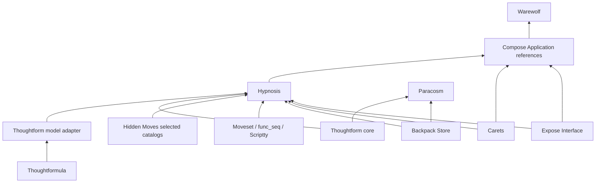

# Cohesion Block B implementation plan

Planning baseline: 19 November 2026. This is the complete architecture and work
register for the first model/harness/world family and reusable terminal
application composition. The [Cohesion Block B Project](https://github.com/orgs/wispsy/projects/28)
and owning issues are the canonical execution queue. This plan records intended
behavior, ownership and acceptance. A proposed interface is not a shipped API.

## Selected next phase — Hero and homegrown training

The [Hero implementation chapter](hero-training.md) adopts the 20 November 2026
selection: Hero general knowledge, Hero Coding specialization, Engl language
records, explicitly approved curricula and a bounded homegrown training pilot.
It records source review, the growing Python vault and Python wiki/docs as
separate candidates, exact checkpoint resume, reusable training jobs and a
15-minute first-experiment ceiling. The Ollama/connected-tool path is deferred.

## 1. Product outcome

A developer can define an individual model with Thoughtform, supply a real
Thoughtformula Transformer and tokenizer, operate a bounded run in Hypnosis,
and observe live results in a Carets application. The same domain behavior is
usable from ordinary Python and Expose Interface commands. Paracosm can compose
model-neutral beings into a deterministic world, including an optional habitat
mind whose proposals pass through the same world rules as other actions.

Hypnosis is the first application proving reusable Carets application design.
Compose Application gains a terminal project profile using Expose Interface and
Carets alongside its existing Expose API and Spatial UI web profiles. Warewolf
is the subsequent Carets hub: one terminal owner hosting a growing collection
of explicitly selected command-line and component applications.

The project must improve the component libraries where a reusable seam is
missing. Application code must not silently replace their responsibilities.
A useful first vertical slice is deliberately smaller than a general autonomous
coding platform, a production model trainer, or a persistent game engine.

## 2. Input evidence and corrections

The supplied local design notes are: `Streaming in Carets.md`,
`Agent Harness Definition.md`, and `hypnosis, thoughtform, paracosm.md`.
Their architectural intent is adopted. They are design input, not evidence that
an illustrative Python interface exists. Their full private paths and unrelated
vault content are not required by the public source tree.

The [Thoughtformula streaming commit](https://github.com/wispsy/thoughtformula/commit/403de839c96fe6b1e4f0a35d6fdf518c4dd27a12)
adds synchronous token-ID generators on `ModernMicroGPT`, including speculative
generation. It does not provide the illustrative `Transformer.load(...)` API,
a cancellable async model service, or a complete agent harness. Use actual
`ModernMicroGPT`, `BPETokenizer`, generator and checkpoint interfaces.

[Wispsy JSONL-01](https://github.com/wispsy/wispsy/issues/14) intentionally waited
for a concrete streaming consumer. Hypnosis now provides that consumer. Adopt
its contract task without duplicating it or equating in-process streaming with
proved subprocess JSONL transport. Its existing prerequisites are complete.

Carets main already has an asyncio queue, serialized updates, commands, task
cancellation, explicit command errors, terminal ownership, forms, focus and test
fixtures. Streaming should extend those mechanisms. Applications use maintained Carets main and its tested public interfaces.
Original local terminal experiments are outside the selected implementation scope.

Thoughtform, Hypnosis and Paracosm start from the user's existing Python 3.14+
uv projects. Public source repository creation is authorized. Package releases,
weight publication, model/data downloads, paid inference and deployment are
separate concrete decisions.

## 3. Architecture and ownership

| Project | Owns | Consumes | Must remain outside |
| --- | --- | --- | --- |
| Thoughtformula | Tensors, autograd, Transformer, tokenizer, samplers, KV caches, LoRA/DPO/KTO mathematics, checkpoint representation | Standard library and its own modules | Harness policies, terminal widgets, beings, world rules |
| Thoughtform | Named individual model definitions, model references/lineage, being identity, observation/action/policy contracts, goals/memories/relationships | Optional model and memory adapters | Another Transformer/trainer, a scheduler, world authority |
| Hypnosis | Run lifecycle, context/tool policy, verification/repair, job assembly, experiment/evaluation tracking, measured harness optimization, Carets application | Explicit providers and existing component libraries | A second general pipeline engine, CLI parser, HTTP stack, database, model math |
| Paracosm | World/habitat state, deterministic clock/step, action validation, rules, authoritative accepted events, save/replay | Thoughtform contracts, optional storage and job adapters | Unchecked model-authored state, implicit weight updates, mandatory environment intelligence |
| Carets | Async terminal runtime, messages, managed streams, renderer/layout/focus/components/themes, terminal cleanup | Standard library; opt-in presentation integrations | Model protocols, domain job state, workflow checkpoints |
| Compose Application | Explicit assembly profiles, safe project generation, reference applications and installed compatibility qualification | Optional selected libraries | A mandatory umbrella runtime dependency for every library |
| Warewolf (later product) | Hub navigation, selected applications, shared terminal shell and services | Carets and explicit app manifests | Global import/plugin scanning, multiple competing terminal owners |

### 3.1 Dependency direction

Thoughtformula stays independent. Thoughtform core stays independent of
Hypnosis, Paracosm and a specific model provider. Its model adapter accepts an
explicit already-configured model/tokenizer and calls public Thoughtformula
methods. Importing the core does not import a Transformer or start work.

Hypnosis consumes neutral model/provider contracts and optionally Thoughtform.
Paracosm consumes Thoughtform and may submit jobs through an optional adapter;
Thoughtform does not import Paracosm. Application assembly imports adapters at
the selected composition root. No pair of core packages imports each other.

Arrows mean optional consumption, not that every base install requires every
lower box. A shared contract document or finite fixture does not create a
mandatory dependency on this reference repository.

## 4. Reuse register and component development opportunities

| Library | Existing capability to reuse | Missing seam to develop only when demonstrated |
| --- | --- | --- |
| Thoughtformula | Real token generators, tokenizer, model/caches, training and checkpoint APIs | Boundary qualification, cancellation at generator steps, stable model/checkpoint compatibility receipts |
| Carets | Program, Command, Msg, renderer, TerminalSession, FocusManager, forms, TestProgram | Managed bounded streams; later frame scheduling, themes, reusable shell and tables |
| Expose Interface | Typed callables, Interface, command/option definitions, usage errors | Reusable command groups/embedding only if application evidence requires it |
| Hidden Moves | Explicit providers, selected CapabilityCatalog, schemas, binding, structured invocation; workspace plugin | Model-neutral tool request/result adaptation and narrow selected capability policies |
| Moveset | Immutable sync/async linear pipeline definitions and explicit references | Compose domain stages without introducing another pipeline language |
| func_seq | Pause/resume, checkpoints, step identity, uncertain-effect recovery | Adapt domain jobs through existing Moveset compilation; no second checkpoint schema |
| Scriptty | Passive JSON/TOML job documents, explicit provider selection, command and Carets frontend patterns | Reuse job inspection/run/resume where applicable; do not fork the workflow runner |
| Backpack Store | Explicit codecs/registered models, SQLite lifecycle, checked revisions, async owner | Typed domain records for runs, memories, worlds and evaluations |
| Enforce Type | Optional structured validation/codecs | Use for richer contracts rather than duplicating schema coercion or validation |
| Kindof | Existing optional type inspection | Inspect selected callables without a new annotation parser |
| Requ | Independent HTTP transport | Ollama/provider cancellation and streamed framing belong in qualified transport adapters |
| Apiconn | Typed API operations and REST/GraphQL composition | Reusable provider operations, not model or harness state |
| Parse MD | Shared Markdown document/parser/renderer engine | Select bounded instruction/document excerpts; no new Markdown parser |
| Headless Spreadsheets | Typed tables, detached snapshots and adapters | Reusable evaluation/run/world table views consumed by terminal and web presentation |
| Escape Colors | Terminal text styling/output | Compatible noninteractive diagnostics; interactive screens retain Carets rendering ownership |
| Expose API | Native API transport, policies and registered resource adapters | Optional remote control/monitoring after a real boundary is selected |
| Spatial UI | Typed native web components/sessions | Optional experiment/world browser views over the same application services |
| Compose Application | Safe exclusive project publication, immutable source selection, source/wheel compatibility profiles | Explicit terminal generation and multi-interface assembly |
| Builtouts | Existing output/artifact composition, where its public contract fits | Evaluate an adapter before inventing a report/export framework |

Reuse means calling public, selected interfaces and improving their owning
library when necessary. It does not mean forcing every dependency into the
first milestone or building wrappers that add no behavior. The small finite
run lifecycle in Hypnosis is domain state, not a general persistent workflow
engine. The first in-memory Paracosm transition function is domain logic, not a
second database or event persistence layer.

## 5. Contracts

### 5.1 Individual model definitions and beings

A model definition identifies a model independently of a character: stable ID,
provider kind, explicit model/artifact reference, generation configuration and
later tokenizer/adapter/checkpoint lineage. A being has its own stable identity,
role, goals and selected model/policy reference. Many beings may share one base
model while keeping independent context, memory and authorization.

Core observation/action values are detached immutable domain records. An
observation identifies the actor, tick and visible information. An action is a
proposal identifying actor, action kind and target/value. A deterministic policy
can implement the contract without any model. Model text must pass explicit
structured decoding/validation before it can become an action or tool request.
No model output is executable Python, an import path, SQL or a shell command.

The initial Thoughtformula adapter is explicit: the caller supplies compatible
model and tokenizer instances plus a definition. It yields token IDs and exact
decoded text fragments through the existing generator. Validate input vocabulary,
finite sampling settings, token budget and the current context-capacity profile.
Zero budget produces nothing without invoking a known zero-budget generator
edge case. Do not hide upstream defects: track them in Thoughtformula and keep
qualification pins explicit. Close the generator on cancellation or early exit.
A tiny untrained model proves integration only; it proves no useful language or
agent capability.

### 5.2 Hypnosis runs and events

Each invocation has an explicit run ID, bounded configuration and one owner.
Events have increasing sequence numbers, run identity, a finite event kind and
bounded payload. Define started, delta/progress and exactly one normal terminal
outcome: completed, canceled, failed or limit reached. Structural failures must
not expose exception text or credentials by default. Cancellation of the
consumer/task must propagate while closing the source; never report completion
from a canceled task's cleanup.

Separate accepted model/tool events from rendering state. A renderer may retain
only a tail while the run enforces independent total output/event/time budgets.
Do not infer completion from a dropped connection, EOF without a terminal record,
a timeout or a model's statement that it finished. A stream can already have
produced useful text or external effects when it fails; that remains visible.

The initial producer is a caller-supplied async iterable, exercised offline.
A real synchronous Transformer must run behind an explicitly managed execution
boundary so it cannot monopolize the Carets event loop. Cancellation is
cooperative at token boundaries; Python threads cannot be forcibly killed.
Process isolation and hard deadlines require their own selected provider task.

### 5.3 In-process Carets streams

`Command.stream(factory, ...)` creates one invocation-owned asynchronous
message producer. The factory is lazy and called only when scheduled. A bounded
queue blocks the producer when delivery is saturated; inputs and stream messages
share serialized model dispatch. Each yielded item must be a Msg. An empty
stream is valid; application-level completion remains an application message.

Program owns producer task identities and cancellation. Program.cancel and
Program shutdown cancel/await producers and close iterators. A producer failure
becomes CommandErrorMsg with the same command ID. Existing commands, timers,
post(), batch semantics and the Python 3.10 floor stay compatible. post() remains
a synchronous event-loop-thread API; the bounded stream path must not pretend
to make arbitrary thread posting safe or bounded.

Bound queue capacity and fairness separately. A bounded queue limits producer
lead, not total state retained by the model. Frame throttling is a later task:
all messages still update the model; only redraws may coalesce. Always flush the
final state and preserve prompt key/resize/cancel handling under load.

### 5.4 JSON Lines and subprocess transport

The [selected stream contract](stream-contract.md) records exact framing, bounds,
process outcomes and the actual-process acceptance required before transport claims.

The selected wire format is a versioned stream of newline-delimited UTF-8 JSON
objects, with one event per physical line. Escape newlines within JSON strings.
Never split a UTF-8 code point or accept duplicate keys/nonfinite numbers. Use
strict schema versions and finite structural depth. Select explicit ceilings:
64 KiB per encoded record including newline, 16 MiB per stream and 100,000
records for the first subprocess profile, or stricter caller budgets.

stdout carries records only; diagnostics go to stderr. A terminal success record
plus a successful producer exit is required for transport success. A failed
record represents an application outcome; malformed framing, wrong sequence,
oversized data, missing terminal state or nonzero process exit is a transport
failure. Never rewrite an uncertain partial run as a successful empty result.

Ordering is per producer/run; no global interleaving claim. Backpressure must
come from actual awaited writes and bounded reads. Stop upstream on downstream
failure/closure, drain or bound stderr, apply deadlines, await process shutdown
and reap children. Handle BrokenPipe, late nonzero exit, cancellation, partial
records and cleanup in actual subprocess tests. No shell parsing, implicit
coercion or globbing is added to Hidden Moves. Existing single-document commands
keep their formats and behavior. JSONL-01 selects this contract; JSONL-02 proves
implementation before any CLI advertises subprocess stream support.

### 5.5 Tools, context and memory

Hidden Moves owns capability discovery, schemas, selected catalogs and binding.
The application chooses exact providers and capability names, authorizes requests,
and configures clients/resources. Installing metadata does not activate code.
Annotations and model tool names never grant authority. Each role has its own
selected catalog and budget; unknown names fail before execution.

Context is bounded and provenance-bearing. Use explicit files/providers and
selective retrieval, not unconditional whole-vault or whole-repository prompts.
Distinguish trusted instructions, task inputs, retrieved text and tool results.
Instructions embedded in retrieved data cannot change provider activation or
authority. Persistent memory stores experiences and domain records through
Backpack, not new pickle formats or callable serialization.

Keep experiential learning, model weight updates and world evolution separate.
A new memory does not trigger fine-tuning. A model proposal does not mutate a
world. Harness optimization does not change weights unless the user selects a
separate training job.

### 5.6 Training and harness optimization

Training job stages are prepare data, validate provenance/config, load source
checkpoint, train via Thoughtformula, evaluate, write a new artifact and register
its lineage. Hypnosis owns when/why and workflow/evaluation policy; Thoughtformula
owns how gradients, optimizers and weights work. Checkpoints are explicit local
artifacts; never overwrite the source, download weights or publish a result as
an incidental step. Select dataset/license/retention and compute budget first.

Harness candidates vary explicit context selection, planning, tool sets, workflow,
verification and repair budgets. Use versioned tasks and seeds with separate
development, selection and held-out test splits. Report verified task success,
failures, latency, tokens, tool calls, repair attempts and compute/resource use.
Compare equal budgets and retain denominators and uncertainty. Store exact
source/provider/model/config/data identities. Candidate promotion and deployment
are explicit decisions; adaptive changes must pass regression and held-out gates.

### 5.7 World authority and replay

Worlds own habitats, actor membership, deterministic tick/order and validated
state transitions. Compute proposals from a defined observation snapshot, then
validate all proposals before committing a step. Do not let later policies
observe partially applied state accidentally. Initial actions are intentionally
small and typed; unsupported kinds and targets fail before mutation.

A habitat mind uses the same policy interface as a being. It can propose actions
within its allowed scope; it cannot bypass rules. Add a pure headless stepping
reference before persistence and sophisticated minds. Save/replay later records
schema/rules/source identity, seed, observations, proposals, accepted actions and
state. Backpack owns persistence; explicit replay does not rerun model inference
and pretend the output is deterministic.

### 5.8 Terminal application and hub composition

Commands call application services; Carets models observe outcomes and own local
view/focus/input state. One Program and TerminalSession own the terminal.
Long-running calls run in commands/managed producers, never awaited inside
update(). A native application must configure a renderer; renderer=None is a
headless mode, not a live display. Untrusted output is displayed as text, with
terminal control characters made visible rather than executed.

Develop design tokens and layout from two real applications: semantic colors,
spacing, surfaces, status/error roles, navigation, focus, shortcuts and narrow
terminal behavior. Reuse Style/FocusManager/widgets before adding abstractions.
Carets issue #10 remains the coherence umbrella; link new evidence to it rather
than claiming the full widget/layout roadmap is finished.

Compose Application's terminal profile uses safe exclusive creation and an
immutable selection receipt. Generated source belongs to the application.
Repeat generation never overwrites source/data or installs dependencies.
Headless check commands must be useful without opening a terminal. Existing
service/ui/live profiles preserve their qualified reference sources. Terminal
requirements must not leak into base/web installs.

Warewolf separates embedded component applications (one Program) from external
process applications (explicit stdio/lifecycle bridge). Define manifests,
selection, services and navigation before a product repository. Activation is
explicit and trusted; do not scan/import every installed package. Start with
Hypnosis plus a second real application such as Scriptty after their embedding
contracts are qualified.

## 6. Python, dependencies, packaging and compatibility

Keep existing package floors: Carets 3.10+, Thoughtformula 3.12+, and the new
family/Compose Application 3.14+. Optional profiles require the intersection of
their selected dependencies. Base imports remain side-effect-free and do not
start event loops, workers, terminals, model inference or database connections.

The new family begins with dependency-free domain cores where practical. Add
Thoughtformula, Carets, Expose Interface, Backpack and workflow dependencies
only to the implementing profile that uses them. The task authorizes these
existing ecosystem integrations, not arbitrary external runtime dependencies.
Use immutable Git source revisions until compatible independent releases are
qualified. Public source repositories are not PyPI publication or name ownership
claims. Keep uv build backends and the user's existing package versions unless
a concrete release task selects new versions. Use existing MIT ecosystem terms
for newly authored source and retain original copyright/attribution.

Build wheels and source distributions. Include the plan, contract guides and
meaningful tests in source artifacts where supported. Source profiles record
full commit IDs, distribution/import names, versions and artifact SHA-256.
Existing unrelated lockfiles, branches, worktrees and user files remain intact.

## 7. Milestones and acceptance

### M0 — Architecture and canonical queue

Adopt this plan, create the public family repositories from existing uv seeds,
reuse JSONL-01 and link cross-project tasks.
Every task has scope, acceptance, dependencies, branch and owning repository.
The original composition and Block A history remains available.

### M1 — First runnable model/harness/terminal/world slice

Deliver managed Carets streams, Thoughtform definitions and its real Transformer
adapter, a finite Hypnosis runner and Carets application, deterministic Paracosm
stepping, and terminal project generation. Demonstrate headless and UI event
consumption with a deterministic source and a tiny Transformer token smoke.
The reference must have bounded state, meaningful errors and cleanup. It need
not claim useful trained model behavior or autonomous coding.

### M2 — A useful single-agent coding harness

Integrate selected Hidden Moves tools, bounded context and skill loading,
Backpack run records, existing resumable workflows, and actual verification/
repair. Add a configured Ollama provider without a new HTTP stack. Acceptance
is a small versioned local coding task completed and checked by real tools under
explicit workspace/model/compute policy, including failure and repair cases.

### M3 — Reproducible specialization and optimization

Select data/checkpoints, orchestrate Thoughtformula training and evaluations,
track individual model lineage and memory, and compare bounded harness
configurations against a held-out baseline. Promotion is separate from search.
A model, a being and a harness each retain independent identity/version history.

### M4 — Persistent worlds and optional hierarchical agency

Save/reopen/replay worlds, integrate bounded habitat minds, export selected
experiences with provenance and support controlled collective policies.
One world, one habitat, two beings and an optional environment mind form the
minimum complete scenario. Rule validation remains authoritative.

### M5 — Reusable design system and Warewolf hub

Qualify shared shell/themes/focus/tables with multiple applications, select the
hub manifest and embedding contract, then build Warewolf with two real apps.
Prove navigation, isolation, background cancellation and one terminal restoration.
Native platform claims follow actual terminal evidence.

### M6 — Independent release selections

Select useful versions and compatible released dependencies for each package,
verify namespace/publisher routing and build exact artifacts. Uploads, tags,
releases, weight publication and deployment require separately authorized
concrete operations. Source development does not wait for synchronized releases.

## 8. Delivery batches

Use rolling batches of three to five focused PRs. Start CI as each task is ready
and continue independent work. Suggested first batch: CB-01, CARET-STREAM-01, TFORM-01, HYP-01 and PARA-01. The following batch includes PARA-01,
CA-CLI-01, JSONL-01 and CB-QA-01, plus a demonstrated focused defect if needed.

Same-repository dependencies can stack; cross-repository dependencies use exact
pushed source revisions and reconcile to merged source before qualification.
For the requested child-first squash strategy, first review and qualify each
focused child diff, squash the passing child into its parent, then qualify the
combined parent and squash it into main. Preserve all child issue/PR links in
the parent description and close child tasks only when the combined source is
on main. Do not delete a parent until no open dependent targets it. Never
force-push or rewrite shared history. Independent PRs merge directly after CI.

A failing Git operation stops dependent Git actions until diagnosed. Focused
behavior checks run after changes/conflict resolutions. Existing CI covers
unchanged work. Final main receives a brief installed startup smoke and current
CI receipts; do not duplicate an exhaustive cross-ecosystem local audit.

## 9. Verification strategy

| Surface | Required evidence |
| --- | --- |
| Managed streams | Incremental pre-exhaustion delivery, ordering, finite lead, slow consumer, input/cancel, close on all paths, source/cleanup errors, existing lifecycle tests |
| Thoughtform | Strict immutable definitions, neutral deterministic policy, actual tiny ModernMicroGPT/BPETokenizer stream, EOS/empty/zero/invalid vocabulary/context boundaries |
| Hypnosis | Event identity/order, exactly one normal terminal outcome, total output/event/time limits, consumer cancellation propagation, iterator closure, CLI stdio and safe terminal display |
| Paracosm | Deterministic snapshot observations/order, valid actions, rejected step atomicity, two beings, optional habitat policy, no implicit model import |
| Project generation | Passive render, installable generated app, actual check command, headless/UI shared domain result, existing profiles, matching repeat preserves edits/data, mismatched destination refusal |
| JSONL transport | Real subprocesses for first-record latency, bounded reads/writes, malformed/oversized/truncated framing, broken pipe, stderr, nonzero exit, cancellation and reaping |
| Persistent workflows | Independent-process resume, no replay of committed steps, explicit uncertain retry/restart, exact definition identity |
| Installed family | Wheel/source installs outside source trees, real model adapter, shared CLI/UI outcomes, artifact/source receipts, no optional import leaks |
| Native terminal | POSIX pseudoterminal/actual keyboard and cleanup where supported; synthetic Windows results are labeled separately |
| Optimization/training | Versioned datasets/tasks/splits/seeds/config, verified outcomes, baseline comparison, protected source checkpoint, lineage and explicit promotion |

Use standard-library unittest and temporary resources consistent with these
repositories. No tests that merely mirror constants; exercise the observable
contract and failure boundaries. Newly introduced CI checks should run on Linux,
macOS and Windows where meaningful. Keep network/model downloads out of normal
unit tests. Avoid claiming an offline fixture validates real provider capability.

## 10. Decisions and boundaries

1. Live model use: choose explicit local checkpoint/model endpoint and hardware
   budget before long inference. A tiny random Transformer integration test is
   permitted and makes no capability claim.
2. Training: choose dataset provenance/license, source checkpoint, evaluation
   split, destination and compute/time budget before training on real data.
3. Agent tool authority: select concrete workspace roots and capabilities before
   autonomous coding/tool execution. Provider metadata alone grants no authority.
4. World persistence: select compatible schema/rule identity and retention before
   durable world/experience adoption. Deterministic in-memory stepping is ready.
5. Design system: derive reusable shell pieces from working apps and retain the
   existing Carets layout/renderer/widget issues as their owning roadmap.
6. Warewolf: select two app contracts and trusted activation/embedding before
   creating a separate product repository.
7. Platform: native POSIX terminal support is the initial qualified boundary;
   Windows/headless compatibility does not prove native console interaction.
8. Publication/deployment: public Git repositories are authorized. Package/model
   releases, uploads, paid services and deployment require concrete authorization.

## 11. Work register

The generated register below links owning issues. Project state, issue bodies
and PR verification supersede this planning snapshot for current status.

| Task | Owner | Scope | Depends on |
| --- | --- | --- | --- |
| [CB-01](https://github.com/wispsy/wispsy/issues/24) | `wispsy` | Adopt Cohesion Block B architecture and delivery plan | — |
| [CARET-STREAM-01](https://github.com/wispsy/carets/issues/20) | `carets` | Manage bounded asynchronous message streams | CB-01 |
| [JSONL-01](https://github.com/wispsy/wispsy/issues/14) | `wispsy` | Select bounded JSON Lines streaming and error semantics | CB-01 |
| [TFORM-01](https://github.com/wispsy/thoughtform/issues/1) | `thoughtform` | Define individual models and neutral agency contracts | CB-01 |
| [HYP-01](https://github.com/wispsy/hypnosis/issues/1) | `hypnosis` | Build a bounded runner and Carets application | TFORM-01, CARET-STREAM-01 |
| [PARA-01](https://github.com/wispsy/paracosm/issues/1) | `paracosm` | Establish deterministic world stepping | TFORM-01 |
| [CA-CLI-01](https://github.com/wispsy/compose_application/issues/52) | `compose_application` | Generate application-owned terminal projects | CB-01, CARET-STREAM-01 |
| [CB-QA-01](https://github.com/wispsy/wispsy/issues/25) | `wispsy` | Qualify the first installed model-to-terminal family | HYP-01, PARA-01, CA-CLI-01 |
| [TF-BOUND-01](https://github.com/wispsy/thoughtformula/issues/20) | `thoughtformula` | Qualify token generation budget and context boundaries | — |
| [CARET-FRAME-01](https://github.com/wispsy/carets/issues/21) | `carets` | Coalesce redraws without dropping messages | CARET-STREAM-01 |
| [CARET-DS-01](https://github.com/wispsy/carets/issues/22) | `carets` | Develop application design tokens and shell composition | HYP-01 |
| [CARET-TABLE-01](https://github.com/wispsy/carets/issues/23) | `carets` | Compose terminal table snapshots and selections | CARET-DS-01 |
| [HYP-TOOLS-01](https://github.com/wispsy/hypnosis/issues/2) | `hypnosis` | Bind explicitly selected Hidden Moves capabilities | HYP-01 |
| [HYP-CONTEXT-01](https://github.com/wispsy/hypnosis/issues/3) | `hypnosis` | Retrieve bounded instructions skills and knowledge | HYP-TOOLS-01 |
| [HYP-MEMORY-01](https://github.com/wispsy/hypnosis/issues/4) | `hypnosis` | Persist typed runs and evaluation records | HYP-01 |
| [HYP-WORKFLOW-01](https://github.com/wispsy/hypnosis/issues/5) | `hypnosis` | Compose resumable jobs through existing workflow libraries | HYP-TOOLS-01, HYP-MEMORY-01 |
| [HYP-VERIFY-01](https://github.com/wispsy/hypnosis/issues/6) | `hypnosis` | Implement bounded verification and repair | HYP-CONTEXT-01, HYP-WORKFLOW-01 |
| [HYP-OLLAMA-01](https://github.com/wispsy/hypnosis/issues/7) | `hypnosis` | Integrate an explicitly configured Ollama provider | HYP-01 |
| [HYP-TRAIN-01](https://github.com/wispsy/hypnosis/issues/8) | `hypnosis` | Orchestrate selected Thoughtformula training jobs | HYP-WORKFLOW-01, TFORM-02 |
| [HYP-EVAL-01](https://github.com/wispsy/hypnosis/issues/9) | `hypnosis` | Establish held-out harness evaluations | HYP-MEMORY-01, HYP-VERIFY-01 |
| [HYP-OPT-01](https://github.com/wispsy/hypnosis/issues/10) | `hypnosis` | Optimize harness choices from measured outcomes | HYP-EVAL-01 |
| [HYP-ORCH-01](https://github.com/wispsy/hypnosis/issues/11) | `hypnosis` | Coordinate bounded multi-agent jobs | HYP-WORKFLOW-01, HYP-EVAL-01 |
| [TFORM-02](https://github.com/wispsy/thoughtform/issues/2) | `thoughtform` | Load and specialize named model definitions | TFORM-01, TF-BOUND-01 |
| [TFORM-MEM-01](https://github.com/wispsy/thoughtform/issues/3) | `thoughtform` | Model memories goals and relationships | TFORM-01 |
| [TFORM-COLLECTIVE-01](https://github.com/wispsy/thoughtform/issues/4) | `thoughtform` | Define collective and environment policy composition | TFORM-MEM-01, HYP-ORCH-01 |
| [PARA-SAVE-01](https://github.com/wispsy/paracosm/issues/2) | `paracosm` | Persist snapshots and deterministic replay | PARA-01, HYP-MEMORY-01 |
| [PARA-MIND-01](https://github.com/wispsy/paracosm/issues/3) | `paracosm` | Add optional bounded habitat minds | PARA-01, TFORM-02 |
| [PARA-EXPERIENCE-01](https://github.com/wispsy/paracosm/issues/4) | `paracosm` | Export bounded experiences for evaluation and training | PARA-SAVE-01, HYP-EVAL-01 |
| [CA-CLI-02](https://github.com/wispsy/compose_application/issues/53) | `compose_application` | Compose terminal and API clients over shared services | CA-CLI-01, HYP-TOOLS-01 |
| [WW-01](https://github.com/wispsy/wispsy/issues/26) | `wispsy` | Define Warewolf terminal hub contracts | CARET-DS-01, CA-CLI-02 |
| [WW-02](https://github.com/wispsy/wispsy/issues/27) | `wispsy` | Build the selected Warewolf hub reference | WW-01 |
| [JSONL-02](https://github.com/wispsy/wispsy/issues/28) | `wispsy` | Prove bounded subprocess event transport | JSONL-01, HYP-01 |
| [CB-QA-02](https://github.com/wispsy/wispsy/issues/29) | `wispsy` | Qualify reusable terminal applications across platforms | CB-QA-01, CARET-DS-01, JSONL-02 |
| [REL-B-01](https://github.com/wispsy/wispsy/issues/30) | `wispsy` | Select independent releases and publication profiles | CB-QA-01 |

## 12. Task acceptance register

### CB-01 — Adopt Cohesion Block B architecture and delivery plan

Owner: [wispsy](https://github.com/wispsy/wispsy/issues/24). Phase: Foundation.

Record source inventory, library ownership, dependency direction, contracts, staged milestones and executable acceptance. Preserve the existing composition plan and adopt terminal applications as an additional profile.

- Publish the complete plan with links to every owning task and source baseline.
- Keep existing library floors, APIs and independent release schedules.
- Identify concrete model/data, platform and release decisions.

### CARET-STREAM-01 — Manage bounded asynchronous message streams

Owner: [carets](https://github.com/wispsy/carets/issues/20). Phase: Streaming.

Add Command.stream accepting a trusted asynchronous iterable factory. Forward typed messages through a bounded delivery path owned by Program, with cancellation, closure and explicit errors.

- Prove incremental delivery before exhaustion, ordering, bounded producer lead and input responsiveness.
- Close sources on exhaustion, errors and cancellation; propagate producer errors as CommandErrorMsg.
- Preserve normal commands, post(), terminal cleanup and Python 3.10 support.

### JSONL-01 — Select bounded JSON Lines streaming and error semantics

Owner: [wispsy](https://github.com/wispsy/wispsy/issues/14). Phase: Streaming.

Use live Hypnosis events as the concrete consumer for the existing JSONL-01 selection. Distinguish in-process messages, JSONL records, subprocess lifetime and application completion.

- Specify UTF-8 framing, strict finite JSON, record/total limits, ordering and backpressure.
- Define cancellation, downstream failure, process errors and uncertain partial effects.
- Keep single-document behavior compatible and require subprocess proof before transport support claims.

### TFORM-01 — Define individual models and neutral agency contracts

Owner: [thoughtform](https://github.com/wispsy/thoughtform/issues/1). Phase: Foundation.

Establish model definitions separate from being identity, observation and action contracts. Supply an explicit optional adapter over real Thoughtformula token generators, never a second Transformer or tokenizer.

- Validate immutable model/being configuration and bounded generation choices.
- Demonstrate deterministic policies without importing model or orchestration packages.
- Prove real tiny Transformer token streaming, stop handling and close behavior with exact source receipts.

### HYP-01 — Build a bounded runner and Carets application

Owner: [hypnosis](https://github.com/wispsy/hypnosis/issues/1). Phase: Foundation.

Build a finite run lifecycle with caller-selected async producers, event sequencing, output/time budgets and explicit terminal outcomes. Provide Expose Interface commands and a Carets frontend consuming the same runner.

- Run an offline synthetic source incrementally through both headless and Carets views.
- Prove completion, cancellation, source failure, time/output limits and cleanup without remote services.
- Keep model math, CLI parsing, terminal ownership, general workflows and persistence in their owning libraries.

### PARA-01 — Establish deterministic world stepping

Owner: [paracosm](https://github.com/wispsy/paracosm/issues/1). Phase: Foundation.

Define bounded worlds/habitats and apply validated Thoughtform actions in deterministic actor order. Environment minds remain optional ordinary policies; world rules are authoritative.

- Repeat a seeded/synthetic episode with identical state and events.
- Reject unknown actors, invalid targets and out-of-scope actions before changing authoritative state.
- Support a habitat with two beings and an optional habitat policy without a model dependency.

### CA-CLI-01 — Generate application-owned terminal projects

Owner: [compose_application](https://github.com/wispsy/compose_application/issues/52). Phase: Composition.

Extend existing project generation with an explicit terminal profile using Expose Interface plus Carets. Reuse current safe exclusive creation and selection receipts, leaving service/ui/live profiles compatible.

- Generate runnable check and terminal commands with owned app source.
- Prove repeat generation preserves edited source and refuses mismatched existing destinations.
- Use immutable qualified source selections and validate the generated application outside its source tree.

### CB-QA-01 — Qualify the first installed model-to-terminal family

Owner: [wispsy](https://github.com/wispsy/wispsy/issues/25). Phase: Qualification.

Record immutable selected sources and execute the family from installed wheel/source distributions. Prove the real Thoughtformula adapter, terminal messages, headless CLI and world reference together.

- Retain source/version/artifact fingerprints and use fresh install processes.
- Require cross-platform CI for headless behavior and identify native POSIX terminal limits.
- Document exact passing scope, remaining tasks and final-main startup receipts.

### TF-BOUND-01 — Qualify token generation budget and context boundaries

Owner: [thoughtformula](https://github.com/wispsy/thoughtformula/issues/20). Phase: Streaming.

Review generator limits with executable probes, including zero/negative budgets, empty prompts, EOS, paged caches and context capacity. Correct any demonstrated defects in Thoughtformula itself.

- Prove zero-token requests never run a forward pass.
- Keep standard/speculative/Medusa return semantics explicit and consistent.
- Document context-capacity behavior and keep adapter guards until compatible sources are selected.

### CARET-FRAME-01 — Coalesce redraws without dropping messages

Owner: [carets](https://github.com/wispsy/carets/issues/21). Phase: Design system.

Provide optional frame scheduling for rapid streams. Serialize every model update while rendering at a bounded configurable rate, with a final frame on completion and no hidden token dropping.

- Use a deterministic clock to prove render bounds and final flush.
- Keep keys, resize and cancel responsive under producer pressure.
- Keep immediate rendering as the compatible default.

### CARET-DS-01 — Develop application design tokens and shell composition

Owner: [carets](https://github.com/wispsy/carets/issues/22). Phase: Design system.

Extend the existing coherent-framework issue #10 with application evidence: theme roles, spacing, shell regions, resize, focus, commands, status and error presentation. Reuse current Style, FocusManager and components.

- Define reusable tokens without a second renderer or terminal lifecycle.
- Prove two independent applications compose the same shell primitives.
- Specify narrow-terminal, Unicode, modal focus and accessible textual state.

### CARET-TABLE-01 — Compose terminal table snapshots and selections

Owner: [carets](https://github.com/wispsy/carets/issues/23). Phase: Design system.

Add a terminal table view over Headless Spreadsheets public snapshots and existing tabular contracts. Preserve stable row/column identity and read-only default behavior.

- Reuse typed values and source identity rather than rebuilding a table engine.
- Prove resize, selection and virtualized bounded rendering.
- Keep persistence edits in existing revision-checked source adapters.

### HYP-TOOLS-01 — Bind explicitly selected Hidden Moves capabilities

Owner: [hypnosis](https://github.com/wispsy/hypnosis/issues/2). Phase: Harness.

Accept a caller-provided selected CapabilityCatalog and typed model tool requests. Authorize tools at the application boundary, validate through the catalog and record structural outcomes.

- Unknown/unselected capabilities fail before invocation.
- Arguments/results use public Hidden Moves schema and finite JSON semantics.
- Tool cancellation and uncertain external effects remain explicit; no registry reimplementation.

### HYP-CONTEXT-01 — Retrieve bounded instructions skills and knowledge

Owner: [hypnosis](https://github.com/wispsy/hypnosis/issues/3). Phase: Harness.

Select task-relevant context from explicit roots/providers using the Hidden Moves workspace plugin and Parse MD where needed. Separate trusted instructions from retrieved untrusted content.

- Bound context bytes/tokens and expose truncation and source provenance.
- Never import code or activate providers from document text.
- Measure retrieval against held-out fixture tasks and exclude secrets from receipts.

### HYP-MEMORY-01 — Persist typed runs and evaluation records

Owner: [hypnosis](https://github.com/wispsy/hypnosis/issues/4). Phase: Harness.

Use Backpack Store public codecs/registered models for run metadata, structural events, evaluation summaries and references to caller-owned artifacts.

- Close and reopen records in an independent process.
- Redact credentials and make transcript retention explicit.
- Keep observation history distinct from checkpoint state and model weights.

### HYP-WORKFLOW-01 — Compose resumable jobs through existing workflow libraries

Owner: [hypnosis](https://github.com/wispsy/hypnosis/issues/5). Phase: Harness.

Build typed training/evaluation/tool stages with Moveset and its func_seq adapter; use Scriptty for passive job documents where useful. Do not create another persistent execution engine.

- Resume completed stages without replay.
- Require explicit retry/restart after uncertain interrupted effects.
- Bind source/config/catalog identity into the existing workflow definition version.

### HYP-VERIFY-01 — Implement bounded verification and repair

Owner: [hypnosis](https://github.com/wispsy/hypnosis/issues/6). Phase: Harness.

Define task success criteria and caller-selected verifier tools; use actual failures as repair input under finite attempts, time and output budgets.

- Prove pass, repair success, exhausted budget and verifier failure.
- Never claim success from model narration alone.
- Preserve a reviewable workspace diff and restrict tool authority by selected policy.

### HYP-OLLAMA-01 — Integrate an explicitly configured Ollama provider

Owner: [hypnosis](https://github.com/wispsy/hypnosis/issues/7). Phase: Providers.

Implement streaming chat/tool results using Requ transport and optional Apiconn operation definitions. Keep endpoint/model/auth/timeouts explicit; test with synthetic HTTP before caller-approved local-model use.

- Handle fragmented UTF-8, completion, malformed records, transport errors and cancel.
- Do not introduce a new HTTP client or hosted service.
- Record provider/model/config identity and avoid equating Ollama chat messages with raw token streams.

### HYP-TRAIN-01 — Orchestrate selected Thoughtformula training jobs

Owner: [hypnosis](https://github.com/wispsy/hypnosis/issues/8). Phase: Training.

Prepare caller-selected data, call existing Thoughtformula trainers, evaluate checkpoints and register artifacts. Training algorithms, tensors, optimizers and checkpoint formats remain in Thoughtformula.

- Require explicit dataset provenance/license, checkpoint destination and compute budgets.
- Never overwrite the source checkpoint or promote a result automatically.
- Exercise prepare/train/evaluate/register with a tiny synthetic dataset and interrupted-job recovery.

### HYP-EVAL-01 — Establish held-out harness evaluations

Owner: [hypnosis](https://github.com/wispsy/hypnosis/issues/9). Phase: Optimization.

Define versioned tasks, seeds, splits, verifier outcomes, latency, tool calls, token/compute budgets and reproducible baselines.

- Separate development, selection and held-out test tasks.
- Report success denominators, uncertainty and failures as well as aggregate scores.
- Compare candidates against a fixed baseline under equal budgets.

### HYP-OPT-01 — Optimize harness choices from measured outcomes

Owner: [hypnosis](https://github.com/wispsy/hypnosis/issues/10). Phase: Optimization.

Search bounded explicit harness configurations such as context selection, tools, workflow and repair budget. Store trial provenance and recommend candidates from evidence.

- Never train weights implicitly during a harness trial.
- Keep a held-out regression gate and explicit promotion decision.
- Reproduce a selected result from immutable task/provider/config sources.

### HYP-ORCH-01 — Coordinate bounded multi-agent jobs

Owner: [hypnosis](https://github.com/wispsy/hypnosis/issues/11). Phase: Orchestration.

Add explicit roles, dependencies, resource admission, concurrency and shared budgets using existing scheduling/workflow seams. Start sequentially on limited hardware.

- Prove no concurrency or compute-budget oversubscription.
- Propagate cancellation and preserve child task outcomes.
- Avoid mutable shared model caches without qualified serialization or isolation.

### TFORM-02 — Load and specialize named model definitions

Owner: [thoughtform](https://github.com/wispsy/thoughtform/issues/2). Phase: Models.

Resolve explicitly supplied checkpoints/tokenizers/adapters with stable model identity and lineage. Multiple beings may share a base model while keeping separate context and memory.

- Call public Thoughtformula load/save/training boundaries.
- Validate tokenizer/checkpoint/config compatibility before use.
- Keep artifact resolution passive and never download weights or train on import.

### TFORM-MEM-01 — Model memories goals and relationships

Owner: [thoughtform](https://github.com/wispsy/thoughtform/issues/3). Phase: Agency.

Define versioned domain records and optional Backpack codecs for experiences, goals and relationships. Recall policies use bounded explicit queries.

- Keep being identity stable across restart.
- Separate memory updates from weight updates and world mutation.
- Support deterministic policies and caller-selected external models equally.

### TFORM-COLLECTIVE-01 — Define collective and environment policy composition

Owner: [thoughtform](https://github.com/wispsy/thoughtform/issues/4). Phase: Agency.

Compose individual, group and environment policy roles through the same observation/action contract and explicit information scopes.

- Keep perspective and authority separate.
- Prove group policies cannot bypass world validation.
- Bound delegation depth, actions and shared-model access.

### PARA-SAVE-01 — Persist snapshots and deterministic replay

Owner: [paracosm](https://github.com/wispsy/paracosm/issues/2). Phase: Worlds.

Use Backpack Store for typed snapshots and world events, including schema/rules/seed/source identity. Support pure headless save/reopen/replay.

- Reopen and replay in separate processes with identical accepted state.
- Detect incompatible rules/schema versions before applying events.
- Do not treat model narration or harness logs as authoritative world state.

### PARA-MIND-01 — Add optional bounded habitat minds

Owner: [paracosm](https://github.com/wispsy/paracosm/issues/3). Phase: Worlds.

Represent environment minds as ordinary Thoughtform policies proposing environmental actions that Paracosm validates against declared rules.

- Run one habitat and two beings with or without a habitat policy.
- Prove rejected proposals preserve authoritative state.
- Share base models optionally without requiring a model per habitat.

### PARA-EXPERIENCE-01 — Export bounded experiences for evaluation and training

Owner: [paracosm](https://github.com/wispsy/paracosm/issues/4). Phase: Worlds.

Export versioned observations, proposals, accepted actions and outcomes with provenance for caller-selected evaluation/training jobs.

- Separate simulated claims from verified outcomes.
- Require explicit data selection/retention and split lineage.
- Keep exports deterministic and reject incompatible schemas.

### CA-CLI-02 — Compose terminal and API clients over shared services

Owner: [compose_application](https://github.com/wispsy/compose_application/issues/53). Phase: Composition.

Demonstrate one application service with direct Python, Expose Interface commands, Carets views and optional Expose API transport. Reuse shared contracts and keep presentation state local.

- Keep CLI parsing and HTTP policy in their existing libraries.
- Prove equivalent results and cleanup across selected interfaces.
- Keep web/browser profiles independent and optional.

### WW-01 — Define Warewolf terminal hub contracts

Owner: [wispsy](https://github.com/wispsy/wispsy/issues/26). Phase: Hub.

Select the application manifest, explicit entry-point discovery, trusted activation, navigation, shared services and embedding contract for Warewolf as a Carets application and hub.

- Embed components under one Program and one terminal owner.
- Separate external-process apps from in-process component apps.
- Select a concrete first pair of applications before creating a product repository.

### WW-02 — Build the selected Warewolf hub reference

Owner: [wispsy](https://github.com/wispsy/wispsy/issues/27). Phase: Hub.

Compose two explicitly selected terminal applications with shared theme/focus/navigation and independent app state; provide a bounded external-process bridge only if selected.

- Switch apps without losing state or leaking background jobs.
- Restore terminal state once on quit/error/cancel.
- Keep plugins opt-in and installations separate from activation.

### JSONL-02 — Prove bounded subprocess event transport

Owner: [wispsy](https://github.com/wispsy/wispsy/issues/28). Phase: Streaming.

Implement the selected record contract through the appropriate transport owner and an actual producer/consumer subprocess reference. Keep the in-process Carets stream adapter independent.

- Prove first record arrives before producer exits.
- Prove malformed/oversized records and downstream closure stop upstream work.
- Report partial effects, timeout, cancellation and nonzero producer exit without false completion.

### CB-QA-02 — Qualify reusable terminal applications across platforms

Owner: [wispsy](https://github.com/wispsy/wispsy/issues/29). Phase: Qualification.

Qualify source/wheel profiles, terminal restoration, process streaming, Unicode/resizing and independent applications across declared platform capabilities.

- Distinguish synthetic Windows tests from native terminal evidence.
- Record exact versions, hashes and platform limitations.
- Keep unaffected published/library profiles compatible.

### REL-B-01 — Select independent releases and publication profiles

Owner: [wispsy](https://github.com/wispsy/wispsy/issues/30). Phase: Release.

Select useful package versions, namespaces, licenses, compatible released dependencies, artifacts and authenticated publisher routing independently for each package.

- Require a separately authorized concrete package upload or release.
- Do not equate public source repositories with PyPI ownership or availability.
- Do not deploy models, services, sites or weights as part of source development.

## 13. Inspected source baseline

These are source revisions, not synchronized package releases. Ancillary entries
are an inventory of inspected local sources and must be requalified before an
integration pins them. The first installed-family receipt selects exact merged
sources separately.

| Component | Baseline | Evidence |
| --- | --- | --- |
| Carets | `e4b5314ecc5459288585d52370e36ee57507ab1f` | Runtime/commands/focus/forms/terminal/tests inspected |
| Thoughtformula | `d61dca801b4adb3addf8f72282d87281ca091f19` | Actual generators, tokenizer, context limit, public exports inspected |
| Wispsy | `530bac98059eb1de71cd09a5645c52647457611b` | Existing composition architecture and JSONL-01 queue retained |
| Compose Application | `8c17590a9d3bfc4285b0f8705b19e0e2ba50d18b` | Existing exclusive project creation and fixed web reference selection inspected |
| Expose Interface | `8c71caefe67217bb6df87e280261746a3055fc86` | Current main identity verified; callable command API inspected |
| Moveset | `95acbde15881ca9d3ca833c16bc6c93b44687fbc` | Existing linear pipelines and func_seq compilation source inventory |
| func_seq | `b1a5346feeeef3fa1f398e4dcd81c2d23345386c` | Existing pause/resume and uncertain-effect recovery contract |
| Scriptty | `f7e1d35f27f997a2e30c6f04f3626f05d8be10cf` | Selected catalogs, commands and terminal composition patterns inspected |

New repositories begin from preserved uv project seeds at Python 3.14+ and
version 0.1.0. No package publication is implied. Project issues and source PRs
record subsequent implementation and exact test receipts.

## 14. First source milestone and reproducibility

The first model/harness/world/terminal slice is implemented in the owning
repositories. Its [qualification guide](qualification.md) and immutable
[source register](sources-v1.json) define the exact installed profile and
practical limits. The Project/PRs retain current checks and merged source state.

Thoughtform definitions and real Transformer adaptation, Hypnosis's finite
runner/Carets application, Paracosm deterministic world steps, Carets managed
streams and Compose Application terminal generation are independently useful.
The wire contract is selected; actual subprocess transport remains JSONL-02.
Later coding-harness/tool/context/persistence/training/optimization and Warewolf
work retains the acceptance criteria and concrete decisions above.

## 15. Hero curriculum and training continuation

# Hero: homegrown model and training implementation plan

Selected on 20 November 2026. This chapter extends Cohesion Block B with Hero,
her Hero Coding specialization, Engl, explicit dataset-source review and an
end-to-end homegrown training milestone. It adopts the supplied curriculum,
English lexical/AST and Wikipedia-reference design notes as design input.
Illustrative APIs and earlier model-size projections are not shipped contracts
or evidence of useful model ability.

The [Project](https://github.com/orgs/wispsy/projects/28) and linked issues own
scope, dependencies and current state. [Engl](https://github.com/wispsy/engl)
has its own [language-foundations Project](https://github.com/orgs/wispsy/projects/29).
The existing thoughtformula roadmap retains numerical/model ownership.

## Selected outcome and priorities

- `hero`: an experimentally trained general-language/general-knowledge model and
  agent identity, starting from random Thoughtformula weights.
- `hero-coding`: a separately identified coding specialization of a selected
  Hero checkpoint, with explicit parent/recipe/data lineage.
- Hypnosis: the application that prepares approved corpora, operates training,
  evaluates results, records typed receipts and exposes progress through Carets.
- Engl: independent English lexical, morphological, dependency and later
  semantic representations, usable without a model or harness.

The immediate target task is operating model training through the harness.
Connecting an Ollama model and externally selected tools is a later path.
A completed pilot produces actual learned checkpoint artifacts and measured
results; it does not establish a general assistant or autonomous coding agent.
No candidate is promoted merely because training completed.

## Source selection is a first-class contract

The priority is internally authored/generated material, then open external
sources, then other sources only after explicit selection. The owner reviews
all new sources, including coding data, teacher outputs, vault snapshots and
new generator recipes. A source being readable, public or locally stored does
not silently add it to the approved training mixture.

[HYP-SOURCE-01](https://github.com/wispsy/hypnosis/issues/13) records the concrete
source catalog, pilot examples and decisions. The internally generated v1
arithmetic/Python recipe was explicitly approved for this pilot on 20 November.
Its approved families are addition, multiplication, parity filtering and list
aggregation. Preserve generator/version/seed identity and independently verify
the authored expected results and tests. Expanding source families needs another
selection; generated text derived from an external source retains that lineage.

The following local downloads were selected by the owner:

| Source | Available input | First use |
| --- | --- | --- |
| TinyStories | V1 train and validation text; downloaded README and commit metadata | Bounded narrative training and held-out language evaluation |
| Simple English Wikipedia | bz2 multistream XML plus bz2 offset/page/title index | Bounded simple factual prose and citation-preserving extraction |
| English Wikipedia | bz2 multistream XML plus bz2 index; separate article shard | Later knowledge expansion; bounded indexed samples now |
| Wiktionary/Wiktextract | gzipped JSONL, multiple languages | Explicit English lexical/morphological normalization |
| UD English EWT | CoNLL-U train/dev/test and repository license/readme | Annotated dependency records and linguistic fixtures |

The directory actually inspected is `Documents/Projects/_datasets` under the
owner's home. Runtime manifests take an explicit dataset root; public source
never depends on that private absolute path. TinyStories is the dataset present,
rather than the name SimpleStories. Local TinyStories metadata matches Hub
revision `f54c09fd23315a6f9c86f9dc80f725de7d8f9c64`; its card declares
`cdla-sharing-1.0`. Three downloaded entries are empty placeholders and must be
reported/excluded rather than treated as valid empty training sets. V1/V2
TinyStories overlaps are not mixed across training/evaluation.

Record source terms and attribution alongside each selection. UD's annotations
and underlying text have distinct provenance described by its README. Preserve
Wikimedia/Wiktionary attribution and share-alike information; do not relabel
external data as repository MIT source. Public source development does not
publish corpora, derived datasets or weights.

### Original candidate source path (20 November)

The growing `vaults/python3` is an explicitly proposed source. The inspected
snapshot has 2,486 Markdown files, about 2.9 MB, including authored notes and
pages citing Python documentation. Propose an exact file allowlist, retain each
file's references/authorship classification and record content hashes. New or
changed files must not silently enlarge the approved snapshot. Keep vault text
local. Use Parse MD's public document/code interfaces for Markdown selection.

`wiki.python.org` is a separate candidate from `docs.python.org`. Select the
community wiki's exact pages/snapshot/terms independently. For official Python
docs, propose a version-pinned tutorial/language/built-in/standard-library subset
and retain the PSF and code-example licensing information. Do not start a bulk
crawler or add either candidate to training before selection.

For future general knowledge material, seek readable explanations with stable
source/revision identity, supporting facts and checkable questions. For coding,
seek explanations plus runnable examples, exercises, tests and debugging pairs.
Other code repositories, textbooks, commercial content and teacher APIs remain
unselected until their concrete source scope is approved.

## Component responsibilities and reuse

| Owner | Selected responsibility | Reuse boundary |
| --- | --- | --- |
| Engl | Lexemes, senses, forms, POS, dependency annotations and future semantic relations | Standard-library bounded import; optional adapters; no model math/storage engine |
| Thoughtformula | Transformer/tokenizer, loss/autograd/Adam, bounded pretraining/evaluation, lossless training state | Reuse FlatTensor and ModernMicroGPT; preserve existing quantized inference formats |
| Thoughtform | Hero/Hero Coding recipes, local model artifact resolution, tokenizer/config compatibility and lineage | Public Thoughtformula artifact APIs; no independent trainer or checkpoint codec |
| Hypnosis | Source approval, corpus streams, curriculum order, jobs, resource policy, evaluation and experiment records | Existing Carets, Expose Interface, Backpack and func_seq services |
| Backpack Store | Typed durable run/metric/artifact-reference records | Explicit codecs, close/reopen and checked updates; no second SQLite schema engine |
| func_seq | Persistent stage lifecycle and uncertain-effect recovery | Prepare/train/evaluate/register trusted callables with exact definition identity |
| Moveset/Scriptty/Hidden Moves | Later selected-catalog job/tool composition | Keep existing interfaces; the initial direct training workflow does not need tool activation |
| Parse MD | Markdown/code selection for an approved vault snapshot | Do not write another Markdown parser |
| Astree | Existing HTML tree/selector/extraction boundaries | It currently parses HTML; linguistic syntax/semantics belong in Engl |
| Carets | One terminal owner and live bounded presentation | Reuse managed streams; numerical work stays off the event loop |
| Pocket Python | Future separately qualified code-exercise execution profile | Initial authored fixtures use the selected CPython; no new interpreter is written |

Wikipedia is Wikitext, not Markdown or HTML. Use a selected Wikitext parser for
markup/citation nodes rather than pretending Parse MD/Astree parses that language.
The initial optional data profile uses mwparserfromhell 0.7.2, confined to the
Wikipedia adapter. Standard XML/bz2/gzip/JSON readers remain incremental and
bounded. No new model framework, hosted service or HTTP client is introduced.

## Engl contracts

A lexeme retains a stable source-qualified identity, lemma, native POS and
explicit mapping to UD POS where known, multiple senses, glosses, examples and
tagged forms. Filter `lang_code == en` explicitly. Preserve ambiguity rather
than collapse every spelling into one meaning. Comparative/superlative degree
is grammatical; it is not intensity or a universal numerical sentiment score.
Relations and calibrated semantic dimensions are later separately evidenced data.

CoNLL-U import validates ten columns, bounded basic word IDs, a single root,
head references and acyclicity. Retain multiword/empty-node metadata and enhanced
annotations without confusing those with basic tree nodes. An annotated-tree
reader is not a parser for arbitrary unannotated English. The next Engl task
selects simple clauses/negation/comparison representations and their evaluation.

## Bounded corpus and citation extraction

The inspected 27 GB compressed full-Wikipedia dump does not need full extraction
for this pipeline. Both real multistream indexes successfully selected and
independently decompressed a 100-page block. Index records use byte offset,
page ID and page title. Validate nondecreasing offsets, dump bounds, compressed
and expanded block ceilings, XML/entity handling and page/revision identity.
A mismatched/invalid index is an error, not permission to decompress everything.

Limit records, scanned bytes, compressed/expanded blocks, document text, output
bytes and retained memory. Inspect input size/version and detect changes during
preparation. Source-stat/sample checks are labeled as such; they are not a
full-file cryptographic verification. Hash the exact selected corpus and selected
compressed blocks/records for reproducibility. Do not hash/read all 27 GB just
to build a small first sample. Never modify or extract over the source downloads.

Keep page IDs, revision IDs, source URLs, raw text identity, inline citation
markers, reference definitions and URLs/DOIs. Cleaned prose and original reference
relationships are separate data. Preserve named/reused references and label
unresolved references. A citation is a relationship, not a verified support verdict.
Bound/truncate excerpts explicitly and record truncation; do not silently present
partial evidence as the full article. No reference URL is fetched automatically.

TinyStories streams split on the actual end-of-text delimiter and preserve the
provided validation source. UD train/dev/test retains the repository split.
Group Wikipedia revisions/related topic sources and future reference documents
before assigning training/validation/test. Deduplicate exact selected content
across the selected mixture; all derived chunks inherit their parent group split.
Evaluation material never enters tokenizer fitting or training sample construction.

## Reproducible model training and artifacts

Expose pretraining/evaluation in Thoughtformula over existing numerical methods.
Validate finite integer/float limits, vocabulary IDs, context length, token/step
budgets, elapsed time and callback/cancellation boundaries. Use token-weighted
negative log likelihood and explicit token counts; detect nonfinite state.
Do not silently drop unsupported tokenizer text in held-out evaluation: report
coverage or fail the selected profile. A predeclared ASCII/code alphabet is
permitted; fitting still uses only training material, never held-out examples.

The existing inference checkpoints quantize weights and omit Adam moments.
They are useful inference artifacts but cannot establish exact training resume.
Add a versioned lossless native training artifact with float64 parameters, Adam
moments/counters, tokenizer/config identity and training progress. Validate
manifest/shape/entry/byte limits, avoid pickle, write atomically and preserve
source artifacts. Resume must match uninterrupted training under fixed data,
seed/order/config. A specialization is a new run: retain parent weights and
lineage while explicitly resetting optimizer/progress where its recipe says so.

Hero and Hero Coding use the same qualified Transformer/tokenizer foundation.
A coding child cannot silently change vocabulary or claim an unrelated model
as its parent. Store model IDs, recipe versions, artifact hashes, tokenizer
fingerprint, corpus/split/approval identities, training-source revisions and
parent artifact identities. Registration records an experimental candidate;
it does not automatically promote a default model or publish weights.

## Harness workflow and application

Use func_seq prepare/train/evaluate/register stages. Bind corpus/config/recipe
and exact source identities into the workflow definition version. Resume saved
completed stages without replay. An interrupted stage can have partial effects;
ordinary resume refuses uncertain state and retry/restart stays explicit.
Thoughtformula's training checkpoint provides numerical resume within a selected
stage; it does not replace func_seq's job state. Backpack stores typed structural
run/evaluation/artifact records; it does not replace either checkpoint format.

Expose the same job through Python, Expose Interface commands and a Carets
training view. Keep input/cancel/resize responsive; one Program owns the terminal.
Use bounded progress events and caller-owned local artifact directories. Record
source/checkpoint paths locally and keep public receipts free of private vault
text or credentials. Time limits are cooperative at numerical boundaries unless
an explicitly owned worker process supplies a hard termination boundary.

## First experiment and acceptance

The combined first local training experiment is capped at 15 minutes, selected
by the owner. Benchmark a small architecture first on the actual 16 GiB machine;
record parameter count and measured throughput before scaling. Earlier 1–5M,
10–30M and larger model suggestions are research targets, not feasible-throughput
claims for a pure-Python implementation. Select a measured pilot architecture,
retain full-precision training artifacts and a compatible inference export.

Run an approved staged curriculum and a seeded shuffled comparison over the same
selected training material, with matched step/token budgets where possible.
Continue a selected Hero checkpoint into the approved Hero Coding curriculum.
Report actual completed steps/tokens/runtime, initial/final train/held-out losses,
coverage and small-sample limits. Keep selection/held-out test data independent.
The small pilot supports pipeline validation and preliminary learning evidence;
no coherent-story, factual-reasoning or functional-coding claim follows solely
from lower language loss or syntactically valid output.

Start the bounded job only after the selected data/config artifacts exist. Report
its actual scheduled stop time in PST. While it runs, continue CI, documentation
and integration work, then collect results. Raw datasets, vault snapshots and
checkpoint weights remain local in ignored artifact directories. Publish only
selected source code and bounded structural/aggregate experiment receipts.

## Subsequent curriculum and evidence work

Progress from lexical/grammar/narrative foundations to knowledge, verifiable
reasoning, instruction, agentic trajectories and specialization, keeping replay
mixtures and regressions explicit. These are measured stages, not guaranteed
capabilities inferred from model size. New textbooks, code, teachers, curricula,
experiential sources and evaluation benchmarks pass source selection first.

Wikipedia/reference curricula preserve claim-to-reference relationships and
allow supported, partial, contradicted and insufficient-evidence outcomes.
Reference-to-summary, retrieval, synthesis and verification are different tasks;
summary-to-reference is not lossless reconstruction. Review exact lawful
reference collections and topic/source holdouts before retrieval. A visible
abstract is not automatically selected training content. Later source-approved
Wikidata/WordNet data can extend semantic records without forcing a model to
memorize every lexical relationship.

## Selected work register

| Task | Owner | Result | Prerequisites |
| --- | --- | --- | --- |
| [HERO-PLAN-01](https://github.com/wispsy/wispsy/issues/35) | `wispsy` | Define Hero homegrown curriculum and source-selection roadmap | — |
| [HYP-SOURCE-01](https://github.com/wispsy/hypnosis/issues/13) | `hypnosis` | Review and approve Hero curriculum sources | HERO-PLAN-01 |
| [ENGL-01](https://github.com/wispsy/engl/issues/1) | `engl` | Normalize English lexical and dependency records | HERO-PLAN-01 |
| [HYP-DATA-01](https://github.com/wispsy/hypnosis/issues/14) | `hypnosis` | Build bounded approved corpus streams | HYP-SOURCE-01, ENGL-01 |
| [TF-BOUND-01](https://github.com/wispsy/thoughtformula/issues/20) | `thoughtformula` | Qualify token generation budget and context boundaries | — |
| [TF-TRAIN-01](https://github.com/wispsy/thoughtformula/issues/21) | `thoughtformula` | Expose bounded pretraining and lossless training checkpoints | TF-BOUND-01 |
| [TFORM-02](https://github.com/wispsy/thoughtform/issues/2) | `thoughtform` | Load and specialize named model definitions | TFORM-01, TF-BOUND-01, TF-TRAIN-01 |
| [HYP-MEMORY-01](https://github.com/wispsy/hypnosis/issues/4) | `hypnosis` | Persist typed training runs and evaluation records | HYP-01 |
| [HYP-WORKFLOW-01](https://github.com/wispsy/hypnosis/issues/5) | `hypnosis` | Compose resumable homegrown training jobs | HYP-MEMORY-01 |
| [HYP-CURRICULUM-01](https://github.com/wispsy/hypnosis/issues/15) | `hypnosis` | Build approved internally generated curriculum material | HYP-SOURCE-01, HYP-DATA-01 |
| [HYP-TRAIN-01](https://github.com/wispsy/hypnosis/issues/8) | `hypnosis` | Orchestrate selected Thoughtformula training jobs | HYP-WORKFLOW-01, HYP-DATA-01, TFORM-02, HYP-CURRICULUM-01 |
| [HYP-EVAL-01](https://github.com/wispsy/hypnosis/issues/9) | `hypnosis` | Establish held-out homegrown training evaluations | HYP-DATA-01, TF-TRAIN-01 |
| [HERO-PILOT-01](https://github.com/wispsy/hypnosis/issues/16) | `hypnosis` | Run and record the first Hero and Hero Coding candidates | HYP-TRAIN-01, HYP-EVAL-01 |
| [HERO-QA-01](https://github.com/wispsy/wispsy/issues/36) | `wispsy` | Qualify installed Hero training and curriculum composition | HERO-PILOT-01, ENGL-01 |
| [ENGL-02](https://github.com/wispsy/engl/issues/2) | `engl` | Develop grounded English semantic representations | ENGL-01 |
| [HYP-EVIDENCE-01](https://github.com/wispsy/hypnosis/issues/17) | `hypnosis` | Select citation-linked knowledge and evidence curricula | HYP-DATA-01, HYP-SOURCE-01 |
| [HYP-VAULT-01](https://github.com/wispsy/hypnosis/issues/18) | `hypnosis` | Review and snapshot the growing Python vault curriculum | HYP-SOURCE-01, HYP-DATA-01 |

## Owning-task acceptance

### HERO-PLAN-01: Define Hero homegrown curriculum and source-selection roadmap

Adopt the three new model/language/citation notes, Hero and Hero Coding identities, Engl ownership, approved local sources and a bounded training milestone. Defer the Ollama/connected-tool path.

- Record source approval, corpus provenance/splits, numerical training/checkpoint ownership and model lineage.
- Link the existing training/artifact/workflow tasks rather than duplicate them.
- Define actual local pilot acceptance, capability limits and future dataset/evidence decisions.

### HYP-SOURCE-01: Review and approve Hero curriculum sources

Implement the explicit dataset-source selection process: internally authored/generated materials first, then open external sources, then other sources only after selection. Local python3 vault and Python wiki/docs are candidates until reviewed.

- Record approval before any new source or generator recipe enters training.
- Reject unapproved sources and changed vault snapshots at ingestion.
- Preserve provenance/rights/version and official/grouped held-out split identity.

### ENGL-01: Normalize English lexical and dependency records

Build independent typed English lexical/morphological records from bounded Wiktextract JSONL and validated dependency trees from CoNLL-U. Keep degree, polarity and intensity distinct, without invented universal word scores.

- Preserve lemmas, POS, multiple senses, tagged inflections and source identity; filter English explicitly.
- Validate basic dependency roots, references and cycles while retaining multiword/empty-node metadata.
- Provide real bounded local import receipts and source/wheel tests without a model dependency.

### HYP-DATA-01: Build bounded approved corpus streams

Read approved TinyStories, indexed Wikipedia bz2 blocks, Wiktionary and UD inputs incrementally. Preserve raw/prose/citation provenance, document IDs, deduplication and split isolation, producing bounded local corpus manifests.

- Prove indexed Wikipedia reads without extracting the full dump; reject invalid offsets/oversized blocks.
- Skip/report incomplete zero-byte downloads and preserve official TinyStories/UD held-out splits.
- Fit tokenizer inputs from training selections only; retain reference markers and page revisions.

### TF-BOUND-01: Qualify token generation budget and context boundaries

Complete the existing generation boundary task before exposing trained local artifacts.

- Prove zero-token requests perform no forward pass and invalid budgets fail explicitly.
- Keep standard/speculative/Medusa streaming and nonstream return shapes compatible.
- Bound context capacity and qualify exact supported sources.

### TF-TRAIN-01: Expose bounded pretraining and lossless training checkpoints

Extract reusable pretraining/evaluation over existing tensor/autograd/Adam operations and add atomic lossless float64/optimizer checkpoints for exact resume. Keep the existing quantized inference checkpoint interface intact.

- Bound steps/tokens/context/time, support cooperative stop and report finite token-weighted loss.
- Prove interrupted/resumed training matches uninterrupted training, including Adam moments and counters.
- Reject incompatible or malformed artifacts before unbounded allocation; do not implement model math elsewhere.

### TFORM-02: Load and specialize named model definitions

Complete local artifact resolution and define explicit Hero generalist and Hero Coding child recipes. Validate model/tokenizer/config identity and preserve full checkpoint/parent lineage.

- Load compatible local artifacts using public Thoughtformula APIs without downloads or inference on import.
- Distinguish exact training resume from a new specialization with reset optimizer state.
- Keep Hero and Hero Coding independently identifiable and register only measured experimental candidates.

### HYP-MEMORY-01: Persist typed training runs and evaluation records

Complete the existing typed run record task using Backpack Store public codecs, including approved corpus/config/artifact references and bounded training/evaluation receipts.

- Close/reopen typed records in an independent process.
- Keep transcripts optional and exclude credentials/raw corpora from structural receipts.
- Record run/parent/source identity without introducing another database or checkpoint engine.

### HYP-WORKFLOW-01: Compose resumable homegrown training jobs

Adopt func_seq for explicit trusted prepare/train/evaluate/register stages. The first homegrown training profile does not require external tools or a capability catalog; selected-catalog composition remains a later adapter.

- Resume committed stages without replay.
- Retain explicit retry/restart for uncertain interrupted effects.
- Bind exact corpus, recipe, source and configuration identity into the existing workflow version.

### HYP-CURRICULUM-01: Build approved internally generated curriculum material

Version the reviewed internal arithmetic and Python exercise recipe, deterministic verification and train/validation/test selections. Support staged order versus a seeded shuffled baseline over the same material.

- Only generate training selections from the approved recipe and source snapshot.
- Verify authored exercise answers/code tests and keep held-out examples separate.
- Report generator/version/seed/data identity; do not relabel derived external material as original.

### HYP-TRAIN-01: Orchestrate selected Thoughtformula training jobs

Complete the selected homegrown prepare/train/evaluate/register workflow with bounded local resources, explicit destinations, progress in the Carets application and exact lineage.

- Train Hero from random initialization and specialize Hero Coding from her selected checkpoint using approved data.
- Preserve source checkpoints, enforce output/resource limits and support interrupted-job recovery.
- Use Thoughtformula training/checkpoints, Thoughtform recipes, Backpack receipts and func_seq lifecycle.

### HYP-EVAL-01: Establish held-out homegrown training evaluations

Complete the first provider-independent evaluation profile with fixed splits/seeds, token-weighted losses/perplexity, tokenizer coverage, bounded syntax probes and matched-budget curriculum/shuffle baselines.

- Keep development/selection/test material and source groups separate.
- Report denominators, token/step/time budgets, failures and small-sample uncertainty.
- Do not claim factual accuracy, functional coding success or autonomous agent ability from language loss/syntax alone.

### HERO-PILOT-01: Run and record the first Hero and Hero Coding candidates

Execute the approved local pilot within a combined 15-minute training budget, with a measured architecture, curriculum/shuffle evidence and a coding specialization when its source recipe is approved.

- Retain reproducible corpus/model/source identities and before/after held-out metrics.
- Produce reloadable lossless/inference artifacts and typed run receipts without automatic promotion or upload.
- Record actual parameter/step/token/runtime totals and remaining capability/data requirements.

### HERO-QA-01: Qualify installed Hero training and curriculum composition

Qualify exact merged source/wheel profiles for corpus preparation, approved source admission, training resume, model lineage, persistent jobs and CLI/Carets progress.

- Retain independent-process source/artifact receipts and Linux/macOS/Windows checks.
- Keep full external corpora/weights out of source artifacts and standard CI.
- Verify final main startup and document concrete next source/model-scale decisions.

### ENGL-02: Develop grounded English semantic representations

Extend lexical/dependency records toward simple clauses, negation and comparisons, preserving syntactic annotations alongside explicit semantic relations. Select parser/lexicon additions with source approval.

- Keep comparative degree separate from intensity and calibrated semantic dimensions.
- Represent ambiguity and absent evidence explicitly.
- Reuse Astree at HTML boundaries; do not turn its HTML core into a language model or dictionary.

### HYP-EVIDENCE-01: Select citation-linked knowledge and evidence curricula

Prepare a source-approved claim/reference curriculum using preserved Wikipedia citation links. Select exact lawful reference sources and topic/source-group held-out evaluation before collection.

- Keep claim/support relations distinct from equal-fact or reversible-text assumptions.
- Preserve DOI/URL/revision/licensing and citation-to-claim alignment.
- Do not automatically crawl every reference or assume an accessible abstract is reusable training material.

### HYP-VAULT-01: Review and snapshot the growing Python vault curriculum

Propose exact allowlisted python3 vault files and a content-hashed snapshot, distinguishing authored notes from documentation-derived excerpts. Reuse Parse MD for structured Markdown and code sections.

- Get an explicit selection before consuming candidate vault material for training.
- Detect added/changed files without silently enlarging the approved snapshot.
- Keep private vault text local and retain original per-file references and rights.

## Homegrown delivery and qualification

The homegrown source profile now implements approved bounded corpus preparation,
independent Engl lexical/dependency values, named Hero/Hero Coding recipes and
passive local lineage, exact Thoughtformula optimizer resume, typed Backpack
receipts, trusted func_seq training stages, explicit held-out measurements and
Carets progress. The [installed profile](hero-qualification.md) and
[immutable source register](hero-sources-v1.json) record the concrete contracts.

The first local execution produced experimental checkpoint artifacts and left its
matched shuffle comparison incomplete after a result-delivery failure. Completed-job
recollection was corrected in #26. The v2 session has now completed the matched
1,478-step comparison; [its reporting PR](https://github.com/wispsy/hypnosis/pull/41)
records the follow-up and longer-family measurements under #34. Raw source text and
weights remain local. The owner-approved sanitized
[pilot measurements](https://github.com/wispsy/hypnosis/tree/main/experiments/hero-pilot-v1)
record observed results and the incomplete comparison. No model is promoted, no
curriculum advantage is claimed and no autonomous training-agent ability follows
from next-token loss or syntax.

The installed-code qualification depends on the implemented model/training/
evaluation APIs, independently of completing the next matched experiment.
[HERO-SOURCE-02](https://github.com/wispsy/hypnosis/issues/27) owns the next authored
curriculum, concrete candidate sources, source/window quotas and runtime decision.
[The proposal guide](source-proposals.md) gives the requested material format.
On 21 November the owner approved the current Python vault/tutorials, official
Python 3.14 docs and community wiki clone. The session-v2 section below records
the selected snapshots, mixture and one-hour ceiling. Future additions and
citation-source collection remain owner-selected; Ollama/tools remain deferred.

The numerical qualification also found and corrected a hard-routing finite-
difference fixture in Thoughtformula #23. It preserves model math and tests a
stable routing region. This discovery is registered as TF-GRAD-01.

HYP-DATA-02 qualifies citation groups, ambiguous named reuse and truncation
provenance through authored fixtures; existing corpora remain immutable.

## Session v2: approved Python materials and longer checkpointed experiments

Selected 21 November 2026 under [HERO-SOURCE-02](https://github.com/wispsy/hypnosis/issues/27).
The owner approved the current dataset directory, including the growing Python
vault/tutorials, Python community wiki clone and Python 3.14 stable documentation,
and delegated recipe/progression selection for this session. This selection is
recorded before ingestion. Future material and generator revisions still need
owner selection; no automatic downloads, external teachers or tool-connected
training are introduced.

### Source snapshots and bounded corpus

The training selection uses the canonical text documentation archive. Approved
HTML, EPUB and texinfo archives are alternate views, not extra independent
examples. The wiki is an explicitly labeled migrated community source, including
legacy material; its presence does not establish that examples describe Python
3.14. Source terms and cited derivation remain attached to local records.

| Source ID | Selected scope | Files/pages | Selected bytes | Snapshot fingerprint |
| --- | --- | ---: | ---: | --- |
| `python-vault-tutorials` | Tutorials and introductory top-level notes | 29 | 98,539 | `1e88df3323284629e1520d0ea0e30f21ce9f90bfb5065562dbcedb35435c3831` |
| `python-vault-reference` | Builtins and standard-library reference notes | 2,479 | 2,816,337 | `02e0116dd7e9f1040e21039838eb3cb01265c87b378226f75c5781325dc92162` |
| `psf-wiki-python` | Selected getting-started, introductory and language pages | 79 | 378,397 | `8635c8d45204c22e7af0d2f9b16130a928620773a511571025c51778e2ad7dfb` |
| `python314-docs` | Tutorial, language reference, builtins and selected library text | 42 | 1,816,259 | `eeb482bc8d4eef646e352a1c2b25e10513bd5f3a8fdab39acc58867fed44e0ed` |

The wiki clone revision is `9b86e1393e8a36897f9a7fc46a3a5610508e92a7`; the
fingerprint above identifies the selected content. Full relative file/member inventories and SHA-256
hashes stay in local source cards. The importer rejects changed or added selected
files, symlinks, unsafe/duplicate archive members and oversized expanded input;
it never executes code or follows embedded links. Parse MD supplies Markdown
structure/code spans. Chunks from a page and vault notes with explicit official
documentation references share a split group; exact-content duplicates are also
grouped. This does not claim semantic deduplication across all paraphrases.

Together with the approved internal v1 exercises, TinyStories train/validation,
Simple English Wikipedia, Wiktionary and UD EWT train/dev/test, preparation uses
512 documents per source, at most 10,000 documents, 32 MiB text and 2,048 characters
per document. Official source splits remain fixed. The resulting immutable corpus
contains **4,716 documents**: 2,765 train, 1,198 validation and 753 test, totaling
8,994,130 bytes. Its SHA-256 is
`e8be291ecabd23192f570f337d21feb7bded318f4f8cbf73086cd45e85463336`.
Full English Wikipedia remains compressed and is not part of this recipe.

### Model family, sampling and vocabulary

Thoughtform owns new named `balanced-v2` recipes while `pilot-v1` remains the
unchanged default for existing jobs. The new family uses width 64, two layers,
four attention heads, two key/value heads, two experts, hidden width 128 and LoRA
rank 4. The actual selected Hero has **240,355 parameters** and an **837-token**
vocabulary. Hero Coding specializes that family's selected parent without
changing its architecture or tokenizer.

| Training source | Hero weight | Hero Coding weight |
| --- | ---: | ---: |
| Approved internal v1 exercises | 20 | 20, Python exercises only |
| Vault tutorials | 20 | 30 |
| TinyStories | 20 | — |
| Simple English Wikipedia | 10 | — |
| UD English | 5 | — |
| Wiktionary | 5 | — |
| Vault reference | 5 | 10 |
| Python 3.14 docs | 10 | 35 |
| Community wiki | 5 | 5 |

Largest-remainder source quotas and weighted interleaving prevent later sources
from being starved by the finite window pool. Window/document rotation is
seeded and deterministic; duplicate windows from small sources are reported.
Tokenizer merges fit only a balanced training sample capped at 512 KiB with 64
merges. Its alphabet covers selected training characters and printable ASCII;
held-out unknown-character exclusions remain explicit. Training selection has
zero unknown-character exclusions in the real session. Prepared documents,
selected windows and windows/tokens actually consumed are distinct denominators.

### Experiment sequence and time contract

The combined experiment ceiling is **one hour**, including preparation, probes,
checkpoint I/O and evaluation. The actual scheduled window is 21 November 2026,
6:29:45–7:29:45 PM PST. Every child inherits the remaining hard deadline; controller
recovery preserves the original start/deadline rather than starting a fresh hour.
The frozen installed runtime keeps source development from changing active jobs.

1. Three-step larger-family throughput/shape probe.
2. Complete the old-family shuffled comparison at exactly 1,478 steps, with up to
   eight minutes available. Accept comparison only when pairs, tokenizer, recipe,
   initialization evaluation and step count match the original pilot.
3. Train new Hero from random initialization for up to fifteen minutes.
4. Continue Hero for another fifteen minutes with complete native weights, Adam
   moments and cumulative optimizer/order state preserved.
5. Specialize Hero Coding for up to eighteen minutes at learning rate 0.00075,
   compared with Hero's 0.0015, trimming the phase to the original remaining time.

The new jobs use seed 7, block size 32, 8,192 selected windows, at most 100,000
additional steps and 16 held-out windows per evaluation selection. A weighted
interleaved order is used for v2; the old matched baseline changes only shuffle
ordering. Evaluation retains mixed, coding and general-language losses plus a
syntax probe that parses generated code without executing it. Each denominator
and unknown exclusion is recorded. Different tokenizer families are not compared
numerically as if their losses measured the same units.

### Checkpoint history, exact continuation and collection

Immutable native snapshots are saved every 250 completed steps, with passive
artifact/context sidecars. Latest recovery state remains separate. No old
checkpoint is overwritten or deleted. Per-run ceilings of 128 retained snapshots
and 512 MiB native history stop training gracefully when exhausted. Model weight
publication and automated promotion remain outside this session.

The typed local collection reuses Backpack. Entries bind run/model/profile,
checkpoint, recipe, tokenizer, corpus, specialization parent and exact-continuation
hashes. Indexing is idempotent, validates native artifacts and can inventory old
pilot checkpoints without training. The CLI supports bounded model/profile-filtered
pages and fresh-process reads. Per-run history and the shared `.runs/checkpoints.sqlite`
are local artifacts, not Git contents.

`--continue-artifact` means exact continuation with the same corpus, selected
pairs/order, recipe, tokenizer, block size, learning rate, seed and shuffle policy.
It preserves optimizer state and writes a new destination. Budgets are additional
for that job; cumulative step/token counters must not be summed across continuation
reports. `--parent-artifact` remains a distinct specialization operation with a
new optimizer trajectory. Tests compare split continuation with uninterrupted
weights and Adam state and verify that parent bytes are unchanged.

A controller may reopen a completed session without training. Interrupted recovery
requires inspecting saved native workflow ownership/state; stale locks and
uncertain effects retain func_seq's explicit recovery contract. Child return-code
and output-size receipts diagnose result-delivery failures. They do not establish
a root cause for an unexplained empty child output.

### Delivery, qualification and acceptance

| Task | Owning issue | Acceptance |
| --- | --- | --- |
| HYP-VAULT-01 | [hypnosis #18](https://github.com/wispsy/hypnosis/issues/18) | Approved content-hashed Markdown/archive ingestion, grouping, limits and changed-source rejection |
| TFORM-03 | [thoughtform #7](https://github.com/wispsy/thoughtform/issues/7) | Named v2 recipes; unchanged v1 identities; source/wheel checks |
| HYP-MIX-01 | [hypnosis #32](https://github.com/wispsy/hypnosis/issues/32) | All selected sources receive windows, deterministic quotas and actual consumption audits; v1 compatibility |
| HYP-CHECKPOINT-01 | [hypnosis #33](https://github.com/wispsy/hypnosis/issues/33) | Immutable bounded history, typed collection, exact continuation and source/optimizer identity refusal |
| HERO-SESSION-02 | [hypnosis #34](https://github.com/wispsy/hypnosis/issues/34) | Execute the bounded progression, retain native artifacts, report measurements and any incomplete phase honestly |
| HERO-QA-02 | [wispsy #39](https://github.com/wispsy/wispsy/issues/39) | Independent installed v2 source/wheel profile, exact merged pins and platform CI receipts |
| HYP-TIME-01 | [hypnosis #39](https://github.com/wispsy/hypnosis/issues/39) | Portable UTC/PST deadline display without another runtime dependency |

The [v2 qualification profile](hero-session-qualification.md) is independent of
the immutable v1 and terminal/world profiles. It uses authored tiny fixtures,
not external training text. Linux/macOS/Windows build and install wheel/source
artifacts, check source revisions/dependencies and retain sanitized CI receipts.
The owner has already authorized publishing those receipts and sanitized training
measurements. Reports exclude source text, selected private document IDs, raw
vocabularies, full source inventories, private paths and model weights.

A session report must distinguish active, completed, limited and failed phases;
record the actual frozen runtime/controller identity and recovery interruption;
show old-family matching and per-phase/cumulative counters; inventory retained
checkpoint counts; and preserve general-language regression measurements during
coding specialization. A single seed and short text windows do not establish
factual knowledge, functional coding, assistant usefulness or an autonomous
training agent. These remain experimental local models.

### Next progression after these measurements

Use the retained Hero foundation/continued and Hero Coding checkpoints as a
collection of explicit candidates, not one silently replaced model. Next-session
selection should decide among additional exact continuation on this frozen corpus,
a new owner-authored lesson snapshot, larger context windows, or revised held-out
question/function tests. New data or a changed tokenizer starts an explicit new
recipe/lineage rather than masquerading as exact continuation. The owner continues
to choose future materials; useful authored additions remain explanations,
worked examples, exercises, boundary cases, checkable answers and references.

### Material growth after the frozen-corpus session

[HERO-SOURCE-03](https://github.com/wispsy/hypnosis/issues/42) records the next source/adaptation/budget selection.
More exact continuation can reuse the frozen v2 corpus and existing weights, Adam
and order. Adding new lessons to general Hero needs an explicit warm-start
operation with new corpus/recipe lineage; the current general-Hero continuation
contract intentionally requires the same corpus. The existing Hero Coding parent
specialization remains available.

Select a frozen-vocabulary first warm-start path that preserves learned weights
and token IDs, deliberately resets optimizer state, reports character exclusions
and keeps old checkpoints unchanged. Vocabulary expansion needs its own selected
policy. Reuse Thoughtform artifact/lineage and Thoughtformula native operations,
with changed-data identity, optimizer reset, parent immutability and preserved
general/coding cohort tests. The new material snapshot and additional finite
runtime remain a future selection; this session does not start another window.
